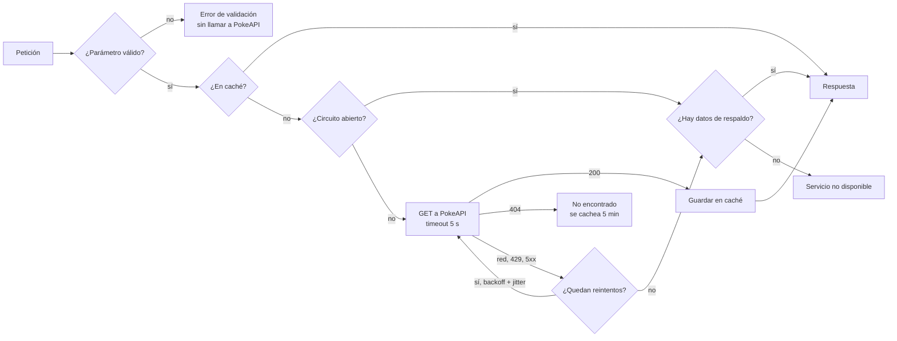

# Pokédex API


API REST para que cada entrenador gestione su **Pokédex personal**: busca Pokémon en la [PokeAPI](https://pokeapi.co/) pública, los guarda en su colección, los marca como capturados, consulta estadísticas y monta equipos de batalla de hasta seis Pokémon.

Práctica 1 del Módulo 2 (APIs REST y fundamentos de integración) de **Sistemas de Información**, Universidad Francisco de Vitoria.

> 🚧 **En construcción.** Este README crece con cada rama `features/` integrada en `develop`. Las secciones que aún no tienen contenido indican qué rama las completará.

## Equipo

Práctica **individual**, autorizada por el profesor.

| Miembro | Usuario Git | Partes desarrolladas |
|---|---|---|
| Sergio Zuñiga Casado | [@szunigacasado](https://github.com/szunigacasado) | Todo el proyecto: API, seguridad, integración con PokeAPI, tests, CI y documentación |

## Stack

| Capa | Tecnología |
|---|---|
| Framework | FastAPI |
| ORM y modelos | SQLModel (Pydantic + SQLAlchemy) |
| Base de datos | SQLite (PostgreSQL opcional) |
| Cliente HTTP | httpx (asíncrono) |
| Configuración | pydantic-settings, variables de entorno |
| Tests | pytest, pytest-asyncio, respx, pytest-cov |
| Calidad | ruff |
| Gestor de paquetes | uv |

## Estructura

```
pokedex-api/
├── app/
│   ├── routers/        # Endpoints agrupados por recurso
│   └── services/       # Clientes de APIs externas (PokeAPI)
├── tests/
├── .env.example        # Plantilla de variables de entorno
├── pyproject.toml      # Dependencias y configuración de herramientas (uv)
├── uv.lock             # Versiones exactas resueltas por uv
└── requirements.txt    # Exportado desde uv.lock para instalar con pip
```

## Instalación

Requisitos: Python 3.12 o superior y [uv](https://docs.astral.sh/uv/) (recomendado) o pip.

```bash
git clone https://github.com/szunigacasado/pokedex-api.git
cd pokedex-api
cp .env.example .env        # y rellena los valores
```

Con **uv** (recomendado):

```bash
uv sync
```

Con **pip**:

```bash
python -m venv .venv
source .venv/bin/activate   # en Windows: .venv\Scripts\activate
pip install -r requirements.txt
```

## Configuración

Ver [`.env.example`](.env.example): cada variable está documentada en el propio fichero.

## Ejecución

```bash
uv run uvicorn app.main:app --reload --no-server-header
```

- Documentación interactiva (Swagger): <http://127.0.0.1:8000/docs>
- Estado del servicio: <http://127.0.0.1:8000/health>

La aplicación no arranca si falta `SECRET_KEY` o si tiene menos de 32 caracteres. En producción tampoco arranca con la clave de ejemplo de `.env.example`.

`--no-server-header` evita que las respuestas revelen qué servidor web se usa. El arranque con HTTPS en el puerto 443 se añade en `features/https-docker`.

## Testing

```bash
uv run pytest --cov=app --cov-report=term-missing
```

Cada test usa una base de datos SQLite en memoria creada desde cero, así que no deja ficheros ni toca datos reales.

### Integración continua

[`.github/workflows/ci.yml`](.github/workflows/ci.yml) se ejecuta en cada *push* a `main` o `develop` y en cada *pull request*. Un PR con la CI en rojo no se integra.

| Trabajo | Qué comprueba |
|---|---|
| **Calidad** | `ruff check` y `ruff format --check`; que `uv.lock` coincide con `pyproject.toml` y que `requirements.txt` coincide con `uv.lock`. |
| **Tests** | Instala desde `requirements.txt` y ejecuta `pytest --cov=app --cov-fail-under=80` en Python 3.12 y 3.13. La cobertura aparece en el resumen de la ejecución. |
| **Seguridad** | `gitleaks` busca secretos en **todo el historial** y `pip-audit` busca vulnerabilidades conocidas en las dependencias. |

Medidas de seguridad del propio flujo:

- Permisos de solo lectura.
- Acciones de terceros fijadas por SHA, para que una etiqueta movida no pueda inyectar código.
- Clave de pruebas propia de la CI, nunca la real.

[Dependabot](.github/dependabot.yml) propone cada semana actualizaciones de dependencias y de acciones, siempre como PR contra `develop`.

## Flujo de trabajo y despliegue

| Rama | Para qué sirve |
|---|---|
| `main` | Versión estable y entregable. Solo recibe *pull requests* desde `develop`. |
| `develop` | Rama de integración de las funcionalidades terminadas. |
| `features/<nombre>` | Una rama por funcionalidad, creada desde `develop`. |
| `fix/<nombre>` | Correcciones de errores ya integrados. |

Cada funcionalidad sigue el ciclo *issue → rama → commits pequeños → pull request → revisión → integración*, con mensajes en formato [Conventional Commits](https://www.conventionalcommits.org/es/). El avance se sigue en el tablero de GitHub Projects del repositorio.

## Endpoints

La documentación completa e interactiva está en **`/docs`** (Swagger). Para probar los endpoints protegidos, pulsa **Authorize** e introduce usuario (o email) y contraseña: Swagger obtiene el token y lo envía en cada petición.

### Autenticación (`/api/v1/auth`)

| Método | Ruta | Auth | Descripción |
|---|---|:-:|---|
| `POST` | `/register` | — | Crea una cuenta. Valida email con regex y la política de contraseñas. `201` o `409` si ya existe. |
| `POST` | `/login` | — | Formulario OAuth2 (`username`, `password`). Devuelve access token (24 h) y refresh token (7 días). `429` si la cuenta está bloqueada. |
| `POST` | `/refresh` | — | Cambia un refresh token por un par nuevo (rotación). Reutilizar uno ya usado revoca la sesión entera. |
| `POST` | `/logout` | — | Revoca el refresh token y los de su misma sesión. `204`. |
| `GET` | `/me` | 🔒 | Datos del usuario autenticado. |

```bash
# Registro
curl -X POST http://127.0.0.1:8000/api/v1/auth/register \
  -H "Content-Type: application/json" \
  -d '{"username": "ash", "email": "ash@kanto.dev", "password": "Pikachu123"}'

# Login (formulario OAuth2)
curl -X POST http://127.0.0.1:8000/api/v1/auth/login \
  -d "username=ash&password=Pikachu123"

# Endpoint protegido
curl http://127.0.0.1:8000/api/v1/auth/me -H "Authorization: Bearer <access_token>"
```

### Pokémon (`/api/v1/pokemon`): proxy a PokeAPI

| Método | Ruta | Auth | Descripción |
|---|---|:-:|---|
| `GET` | `/search?name=&limit=20&offset=0` | 🔒 | Busca por nombre (subcadena, sin distinguir mayúsculas). Devuelve `{id, name, sprite, types}`. |
| `GET` | `/{id_or_name}` | 🔒 | Detalle con estadísticas, habilidades, tipos, sprites y especie (descripción y categoría en español, generación, legendario o mítico). |
| `GET` | `/{id_or_name}/card?format=png\|pdf` | 🔒 | Descarga la ficha del Pokémon como archivo. |

| Situación | Respuesta |
|---|---|
| El Pokémon no existe | `404` |
| Identificador malformado (`pika_chu`, `0`, `'or 1=1`…) | `422`, sin llegar a llamar a PokeAPI |
| PokeAPI caída y sin datos de respaldo | `503` con `Retry-After` |
| PokeAPI responde algo inesperado | `502` |

**Ficha descargable.** Se dibuja con Pillow como carta coleccionable de 600 x 840 px:
- Color según el tipo, con nombre, categoría, tipos y habilidades **en español**.
- Las seis estadísticas con barras.
- Descripción de la Pokédex y marca de legendario o mítico.

La ilustración solo se descarga del repositorio oficial de sprites de PokeAPI (lista de dominios permitidos contra SSRF, solo HTTPS y 2 MB como máximo). El dibujo se hace en un hilo aparte para no bloquear el servidor. La fuente es [Nunito](app/assets/fonts/OFL.txt), con licencia SIL Open Font License, porque la fuente por defecto de Pillow no tiene acentos.

<p align="center"></p>

### Pokédex personal (`/api/v1/pokedex`)

| Método | Ruta | Auth | Descripción |
|---|---|:-:|---|
| `POST` | `/` | 🔒 | Añade un Pokémon. Comprueba en PokeAPI que existe y copia su nombre, sprite y tipos. `409` si ya estaba. |
| `GET` | `/?captured=&favorite=&sort=&order=&limit=&offset=` | 🔒 | Lista paginada con `count` total. `sort`: `pokemon_id`, `capture_date`, `pokemon_name` o `created_at`; `order`: `asc` o `desc`. |
| `GET` | `/{entry_id}` | 🔒 | Una entrada. |
| `PATCH` | `/{entry_id}` | 🔒 | Actualización parcial: solo cambian los campos enviados. |
| `DELETE` | `/{entry_id}` | 🔒 | Elimina la entrada (y la saca de los equipos donde estuviera). `204`. |
| `GET` | `/export?format=csv\|pdf&captured=&favorite=` | 🔒 | Descarga la Pokédex filtrada como CSV o PDF. |

```bash
curl -X POST http://127.0.0.1:8000/api/v1/pokedex \
  -H "Authorization: Bearer <access_token>" -H "Content-Type: application/json" \
  -d '{"pokemon_id": 25, "nickname": "Sparky", "is_captured": true}'
```

**Reglas de negocio:**
- **Autorización por propietario:** todas las consultas filtran por el usuario del token. Una entrada de otro usuario devuelve `404` y no `403`, para no revelar que existe (OWASP API1, *Broken Object Level Authorization*).
- **Sin duplicados:** se comprueba antes de insertar y, además, la restricción `UNIQUE(owner_id, pokemon_id)` de la base de datos cubre el caso de dos peticiones simultáneas. Hay un test que simula esa carrera.
- **Coherencia de la captura:**
  - Capturado sin fecha → se usa la fecha actual.
  - Descapturar → se borra la fecha.
  - No se admiten fechas futuras ni fecha de captura sin estar capturado.
  - Las fechas sin zona horaria se interpretan como UTC.
- **Textos limpios:** se quitan los espacios sobrantes y un apodo o una nota vacíos se guardan como `null`.
- **Datos copiados de PokeAPI:** la Pokédex, sus filtros y sus estadísticas funcionan aunque PokeAPI se caiga.

#### Estadísticas: `GET /api/v1/pokedex/stats?tz=Europe/Madrid` 🔒

```json
{
  "total_pokemon": 9,
  "captured": 8,
  "favorites": 2,
  "completion_percentage": 88.9,
  "most_common_type": "fire",
  "capture_streak_days": 1,
  "longest_streak_days": 1,
  "type_distribution": {"fire": 2, "normal": 2, "poison": 2, "electric": 1, "...": 1},
  "first_capture_date": "2026-10-01T10:00:00Z",
  "last_capture_date": "2026-11-09T11:58:19Z",
  "national_dex_total": 1025,
  "national_dex_percentage": 0.8,
  "timezone": "Europe/Madrid"
}
```

Los seis primeros campos son exactamente los del enunciado. Cómo se calcula cada dato:

| Campo | Definición |
|---|---|
| `completion_percentage` | Capturados respecto al total de la Pokédex, con 1 decimal. Es la definición del ejemplo del enunciado (89 de 150 → 59,3). |
| `most_common_type` | Tipo más repetido entre los Pokémon guardados. En caso de empate gana el primero alfabéticamente, para que el resultado sea siempre el mismo. |
| `capture_streak_days` | Días **consecutivos** con al menos una captura hasta hoy. Si hoy aún no hay capturas pero ayer sí, la racha sigue viva; si la última fue anteayer, vale 0. |
| `national_dex_percentage` | Capturados respecto a todas las especies existentes según PokeAPI (dato cacheado 24 h). Es lo único que depende de PokeAPI: si no responde, vale `null` y el resto sigue funcionando. |

Las rachas dependen de **dónde empieza cada día**: una captura a las 23:30 UTC ya es «mañana» en Madrid. Por eso el parámetro `tz` acepta cualquier zona horaria IANA (por defecto `UTC`). En Windows, que no incluye la base de datos de zonas horarias, se usa el paquete `tzdata`.

**Exportación:**
- **CSV:** estándar RFC 4180, en UTF-8 con BOM para que Excel muestre los acentos. Está protegido contra la **inyección de fórmulas**: un apodo como `=HYPERLINK(...)` se guarda como texto.
- **PDF:** con ReportLab. Incluye un resumen (total, capturados, favoritos), una tabla con el sprite de cada Pokémon, los tipos en su color, la cabecera repetida en cada página y la paginación.

## Decisiones de Diseño

### Rate limiting
_Se completa en `features/rate-limiting-cors`._

### Versionado
_Se completa en `features/api-v2`._

### Otras decisiones

#### Cliente de PokeAPI resiliente

`app/services/pokeapi_service.py` es la única pieza que habla con PokeAPI. Al resto de la aplicación le entrega modelos propios (`PokemonDetail`, `PokemonSpecies`…) con solo los campos útiles: de los cientos que devuelve PokeAPI por Pokémon, se quedan unos 20. También le entrega excepciones de dominio (`PokemonNotFoundError`, `PokeAPIUnavailableError`), nunca errores de `httpx`.

Una API externa gratuita puede ir lenta, fallar o caerse, así que el cliente se protege en capas:



| Capa | Detalle |
|---|---|
| **Validación** | IDs entre 1 y 100 000 y nombres `[a-z0-9-]`. Se rechazan `../`, `?` y espacios antes de construir la URL externa. |
| **Timeout** | 5 s por petición. Una PokeAPI lenta no bloquea los workers de la API. |
| **Límite de reintentos** | 3 como máximo, solo ante errores transitorios (red, *timeout*, 429, 5xx). *Backoff* exponencial con *full jitter*: el azar evita que muchos clientes reintenten a la vez. Se respeta `Retry-After`, con un tope de 10 s. Un 404 no se reintenta. |
| **Circuit breaker** | Tras 5 fallos seguidos se deja de llamar durante 30 s: las peticiones fallan al instante en lugar de esperar *timeouts*. Después se deja pasar una petición de prueba. |
| **Caché** | En memoria, LRU, 1 h por respuesta y 5 min para los 404. El índice de nombres que usa la búsqueda se cachea 24 h. |
| **Concurrencia** | Como mucho 10 peticiones simultáneas, para no abusar de un servicio gratuito. |
| **Datos de respaldo** | [`app/data/pokemon_fallback.json`](app/data/pokemon_fallback.json) con los 151 Pokémon originales y su descripción en español. Se usa solo si PokeAPI no responde. Se regenera con `uv run python -m scripts.generate_fallback_data`. |
| **Logging** | Cada llamada queda registrada con su URL, código y duración. Los reintentos y el uso de datos de respaldo, como *warning*. |

El cliente se crea **una vez** al arrancar (`lifespan`) y se comparte entre peticiones: reutiliza conexiones HTTP y la caché sirve a todos los usuarios.

**Diferencia con la plantilla del enunciado:** la plantilla lanza `HTTPException` desde el servicio. Aquí el servicio lanza excepciones propias y la API las traduce a códigos HTTP. Así el servicio no depende de FastAPI y se puede reutilizar desde un script, como el que genera los datos de respaldo.

## Decisiones de Seguridad

_Resumen; el detalle completo irá en `SECURITY.md`._

### Autenticación

| Medida | Por qué |
|---|---|
| **bcrypt** (coste 12) vía passlib | Hash lento y con sal: un volcado de la base de datos no revela las contraseñas. |
| Contraseña de 72 bytes como máximo | bcrypt ignora en silencio lo que pasa de 72 bytes; se rechaza en lugar de truncarla. |
| Política: 8+ caracteres, mayúscula, número y sin el nombre de usuario | Requisito del enunciado, más una regla barata contra contraseñas obvias. |
| Mismo mensaje y mismo tiempo para "usuario inexistente" y "contraseña incorrecta" | Evita descubrir qué usuarios existen. Si el usuario no existe, se verifica igualmente contra un hash ficticio. |
| **Bloqueo temporal** tras 5 fallos seguidos (`429` + `Retry-After`) | Límite de reintentos por cuenta: frena la fuerza bruta aunque el atacante cambie de IP. |
| JWT con `sub`, `user_id`, `exp`, `iat`, `nbf`, `iss`, `aud`, `jti` y `type` | Validación según RFC 8725: algoritmo fijado al decodificar (rechaza `alg: none` y la confusión de algoritmo), emisor y audiencia comprobados. |
| Access token de 24 h + refresh token de 7 días **con rotación** | Cada refresh token sirve una vez. Si se reutiliza uno, se interpreta como robo y se revoca toda la sesión. |
| El usuario se vuelve a comprobar en la base de datos en cada petición | Un token de un usuario borrado o desactivado deja de valer al momento. |
| `Cache-Control: no-store` en las respuestas con tokens | Ningún proxy ni navegador guarda los tokens en caché. |
| Rehash automático al iniciar sesión | Si se sube el coste de bcrypt, las contraseñas antiguas se actualizan solas. |

### Vulnerabilidades conocidas en dependencias

`pip-audit` señala dos avisos que **no afectan** a esta API. Se ignoran en la CI de forma explícita y justificada:

- **`ecdsa`** (ataque Minerva): afecta a *firmar* con ECDSA. La API solo firma con HMAC-SHA256.
- **`python-jose`** (confusión de algoritmo): requiere una clave pública y no restringir los algoritmos. Aquí la clave es simétrica y `decode_token` fija `algorithms=["HS256"]`. Hay tests que intentan el ataque.

`python-jose` es obligatorio según el enunciado. En un proyecto real se sustituiría por `PyJWT` o `joserfc`.

## Mejoras Futuras

_Se completa al cerrar la versión `v1.0.0`._
